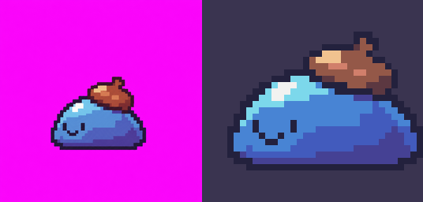
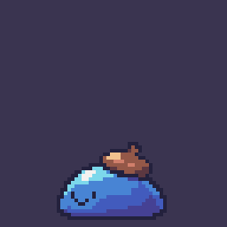
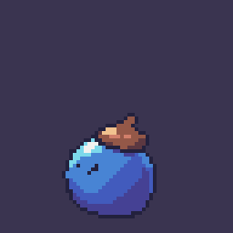
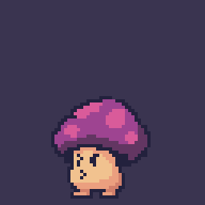
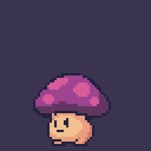

# Ai_Pixel_Perfact

[English](README.md) | **한국어**



| 슬라임 점프 | 슬라임 공격 | 독버섯 걷기 | 독버섯 공격 |
|---|---|---|---|
|  |  |  |  |

모두 이 파이프라인으로 만든 Softmilk 32 팔레트 인덱스 PNG입니다(README용으로 4배 확대).

GPT Image(Codex)로 생성한 픽셀아트를 **게임에 바로 쓰는 픽셀 퍼펙트 스프라이트 시트**로 만드는 Claude Code 워크플로우입니다.

캐릭터 요청 → 프롬프트 작성 → 이미지 생성 → 픽셀 격자 스냅 → 배경 제거 → 프레임 정렬 → 스프라이트 시트까지 자동으로 진행합니다.

## 역할 분담

| 담당 | 하는 일 |
|---|---|
| Claude Code (지휘자) | 컨셉 해석, 프롬프트 작성, 다음 단계 결정, 최종 승인 |
| Codex (GPT Image) | 이미지 생성만 담당 |
| sprite-qa 서브에이전트 (Opus) | `sprite.py` 후처리 실행, 프레임별 검수, 판정표 작성 |

자세한 설계와 흐름은 [`skill/pixel-sprite/ORCHESTRA.md`](skill/pixel-sprite/ORCHESTRA.md), 사용 예시는 [`skill/pixel-sprite/USAGE.md`](skill/pixel-sprite/USAGE.md)에 있습니다.

## 폴더 구조

```
skill/pixel-sprite/        Claude Code 스킬 → ~/.claude/skills/pixel-sprite/ 로 복사
  SKILL.md                 작업 절차 (Claude가 읽음)
  sprite.py                후처리 스크립트 (refs, prompt, gen, snap, sheet, put, animate)
  templates/               이미지 생성 프롬프트 템플릿
  test_sprite.py           자체 점검
  USAGE.md, ORCHESTRA.md   사용법, 설계 문서
project/                   게임 프로젝트 폴더에 복사할 설정
  CLAUDE.md                지휘자 규칙 (생성 예산, 위임 기준, 보고 형식)
  .claude/agents/sprite-qa.md   검수 서브에이전트
  .claude/settings.json    이 프로젝트에서 끌 플러그인 (없으면 무시됨)
  sprites/AGENTS.md        Codex 규칙
  tools/sprite-player.html PNG 시트/프레임 루프 재생기 (브라우저)
  tools/player-app/        같은 재생기의 macOS 앱 (build.sh로 빌드)
docs/side-view-plan.md     옆모습 1방향 기준 캐릭터별 애니메이션 구성과 플랜별 생성량
requirements.txt           Python 패키지
```

## 설치해야 하는 것

| 이름 | 용도 | 설치 | 확인한 버전 |
|---|---|---|---|
| [Claude Code](https://claude.com/claude-code) | 지휘자, 검수 | 공식 설치 안내 참고 | – |
| [Codex CLI](https://github.com/openai/codex) | 이미지 생성 | `npm install -g @openai/codex` 후 `codex login` (ChatGPT 계정) | 0.169.0 |
| [Pixel Snapper](https://github.com/Hugo-Dz/spritefusion-pixel-snapper) | 픽셀 격자 스냅 | `brew install Hugo-Dz/tap/spritefusion-pixel-snapper` | 1.0.0 |
| Python 3.9 이상 | `sprite.py` 실행 | macOS 기본 또는 `brew install python` | 3.9.6 |
| Pillow, numpy | 이미지 처리 | 아래 3단계 | `requirements.txt` |
| [herdr](https://herdr.dev) (선택) | 각 모델의 작업 창을 띄워 진행 과정 보기 | herdr.dev 안내 참고 | 0.9.5 |
| [PixelLab](https://www.pixellab.ai) (선택) | 앵커를 그대로 움직이는 애니메이션 생성 | 가입 후 계정 설정에서 API 키 발급 | API v2, 2026-11 |

macOS(Homebrew)와 Windows 11(Git Bash, `uv`)에서 사용했습니다. Linux는 시험하지 않았습니다.

## 설치 순서

```bash
# 1. 받기
git clone https://github.com/EricDev-4/Ai_Pixel_Perfact.git
cd Ai_Pixel_Perfact

# 2. 스킬 설치
mkdir -p ~/.claude/skills
cp -R skill/pixel-sprite ~/.claude/skills/

# 3. Python 환경
python3 -m venv ~/.claude/skills/pixel-sprite/.venv
~/.claude/skills/pixel-sprite/.venv/bin/pip install -r requirements.txt

# 4. Pixel Snapper
brew install Hugo-Dz/tap/spritefusion-pixel-snapper

# 5. Codex: 로그인하고 이미지 생성 기능이 켜져 있는지 확인
codex login
codex features list | grep image_generation    # "stable  true" 이면 정상

# 6. 게임 프로젝트 폴더에 설정 복사 (숨김 폴더 .claude 포함)
cp -R project/. /path/to/your-game-project/

# 7. 자체 점검: 마지막 줄이 ok 이면 정상
~/.claude/skills/pixel-sprite/.venv/bin/python ~/.claude/skills/pixel-sprite/test_sprite.py

# 8. (선택) PixelLab API 키: 파일에 키 한 줄만 저장 (본인만 읽기)
mkdir -p ~/.config/pixellab && chmod 700 ~/.config/pixellab
touch ~/.config/pixellab/api_key && chmod 600 ~/.config/pixellab/api_key
open -e ~/.config/pixellab/api_key             # 키 붙여 넣고 저장 (Windows: %USERPROFILE%\.config\pixellab\api_key)

# 9. (선택) 재생기 macOS 앱 빌드 (Xcode Command Line Tools 필요)
sh /path/to/your-game-project/tools/player-app/build.sh   # → tools/build/Sprite Player.app
```

## 사용법

게임 프로젝트 폴더에서 Claude Code를 실행하고 요청합니다.

```
보라색 모자를 쓴 마법사 픽셀아트 캐릭터 만들어줘
유냥이 사이드뷰 걷기 스프라이트 만들어줘
```

결과물은 `sprites/<캐릭터>/`에 생깁니다.

| 파일 | 내용 |
|---|---|
| `anchor_west_native.png` | 캐릭터 기본 이미지 (실제 픽셀 크기) |
| `<동작>_west/sheet.png` | 스프라이트 시트 (투명 배경) |
| `<동작>_west/preview.gif` | 애니메이션 미리보기 |
| `<동작>_west/frames/`, `raw/` | 프레임별 이미지, 수정용 원본 프레임 |
| `qa/<동작>.md` | 검수 판정표 |
| `originals/` | AI가 생성한 원본 (다시 스냅할 때 사용) |

게임 엔진에서는 텍스처 필터를 **Nearest(Point)** 로 설정해야 확대해도 선명합니다.

### PixelLab으로 동작 만들기 (권장)

GPT로 동작 시트를 새로 그리는 대신, 승인된 앵커 자체를 움직입니다. 얼굴·비율·색이 프레임마다 바뀌지 않습니다.

```bash
S=~/.claude/skills/pixel-sprite
$S/.venv/bin/python $S/sprite.py animate sprites/banana/anchor_west_native.png sprites/banana/walk_west \
  --frames 8 --prompt "looping walk cycle facing left, ..."
$S/.venv/bin/python $S/sprite.py sheet sprites/banana/walk_west/raw sprites/banana/walk_west \
  --compare sprites/banana/anchor_west_native.png
```

- 출력 프레임이 입력과 같은 크기라 도트 크기가 유지됩니다. 팔레트 고정은 없으므로 색은 `colors.tsv` 재칠과 `check`로 맞춥니다. 학습 사용 거부 옵션도 없습니다.
- 모델: `v3`(기본, 짝수 4~16프레임), `--model pixminimax`(beta, 4의 배수 4~40프레임). 공격처럼 원래 자세로 돌아와야 하면 `--last-anchor`.
- 팔을 머리 위로 드는 동작처럼 키가 커지면 `sheet ... --cell 96`으로 칸을 키웁니다.
- 결과 확인: `open -a "tools/build/Sprite Player.app" sprites/banana/walk_west/sheet.png`

## 주요 규칙

- **기준 방향은 캐릭터마다 사용자에게 묻고**(west 옆모습, south 정면 등) 그 한 방향만 만듭니다. 좌우 반대쪽은 게임 엔진에서 반전합니다.
- **캐릭터 일관성:** 새 캐릭터는 기준 캐릭터(현재 바나나)의 AI 원본을 스타일 레퍼런스로 붙이고, 같은 도트 격자로 강제 스냅합니다.
- **동작은 PixelLab이 기본**입니다. 키가 없거나 잔액이 모자라면 GPT 동작 시트로 대신합니다.
- **생성 예산:** 캐릭터당 이미지 1장, 요청한 동작당 1회가 기준입니다. 재생성은 이미지당 1회까지 자동으로 하고, 그 이상은 사용자에게 묻습니다.
- **도트 크기 통일:** 모든 파일은 도트 1칸 = 1px이고 엔진에서 2배로 키웁니다. AI 그림은 정해진 격자(1024 그림 16px, 포즈 보드 8px)로 snap하고 리사이즈하지 않습니다. 동작 시트는 `sprite.py sheet ... --compare <앵커 native 파일>`로 처리하며, 키가 앵커와 2칸 넘게 다르면 경고합니다.
- **파일 정리:** 확인용 확대본은 남기지 않고, 채택한 AI 원본만 `originals/`에 보관합니다.

## 알려진 제약

- **Codex 이미지 크기:** 요청한 크기를 따르지 않습니다(1024 요청 → 1254, 2048x1536 요청 → 1448x1086). 후처리에는 문제가 없습니다.
- **격자 불일치:** 모델이 생성 격자를 지키지 않으면 `grid ... not honoured` 경고가 나옵니다. 그 그림은 도트 크기가 다를 수 있으니 재생성하는 것이 좋습니다.
- **걷기 동작 (GPT 시트):** 이미지 모델이 걷기를 어려워합니다. `USAGE.md`의 걷기 전략(4프레임 키포즈 + 중간 프레임)을 참고하세요.
- **맵 타일셋:** 아직 지원하지 않습니다. 이음새 처리와 격자 자르기가 필요해서 별도 워크플로우가 필요합니다.
- **아이템:** 직접 생성한 GPT 이미지를 `sprite.py snap` / `sheet`로 후처리할 수 있지만, 배경이 단색 마젠타(#FF00FF)가 아니면 배경 제거가 되지 않습니다.

## 라이선스

[MIT](LICENSE)
