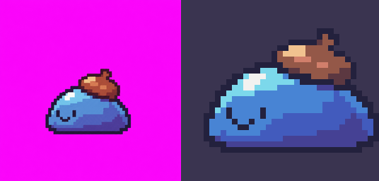
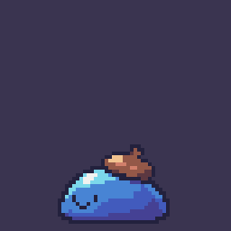
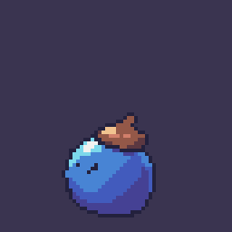
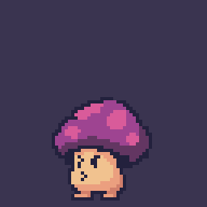
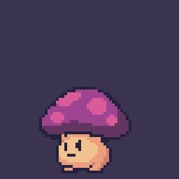

# Ai_Pixel_Perfact

**English** | [한국어](README.ko.md)

Turn AI-generated pixel art (GPT Image via Codex, PixelLab) into **pixel-perfect, game-ready sprite sheets**: one dot = one pixel, a fixed shared palette, no semi-transparent pixels, 8-bit indexed PNG output. It runs as a [Claude Code](https://claude.com/claude-code) skill.



| Slime jump | Slime attack | Mushroom walk | Mushroom attack |
|---|---|---|---|
|  |  |  |  |

All made with this pipeline, recoloured to the Softmilk 32 palette (shown x4 for the README).

## Why

Image models draw "pixel art" with blurry edges, mixed block sizes, off-palette colours and a face that changes every frame. This pipeline fixes that after generation:

1. **Snap** the image to its real dot grid (no non-integer resizing).
2. **Remove** the magenta `#FF00FF` chroma-key background, with despill.
3. **Recolour by material**: each source colour maps to a colour in the same material ramp of the shared palette. It is not a nearest-colour quantise. You approve the colour table per sheet.
4. **Check** the saved file: colour count, off-palette colours (hex, count, position), semi-transparent pixels.
5. **Pack** frames into one sheet with a fixed foot anchor and one cell size per character. Publish an 8-bit indexed PNG only when the check passes.

Animations: by default, [PixelLab](https://www.pixellab.ai) animates the approved anchor sprite itself, so the face and proportions stay the same. Idle is made from the anchor without any generation.

## Roles

| Who | Does |
|---|---|
| Claude Code (conductor) | Reads the concept, writes prompts, decides the next step, final approval |
| Codex (GPT Image) | Image generation only |
| `sprite-qa` subagent | Runs `sprite.py`, reviews frame by frame, writes the QA table |

Design: [`skill/pixel-sprite/ORCHESTRA.md`](skill/pixel-sprite/ORCHESTRA.md). Usage examples (Korean): [`skill/pixel-sprite/USAGE.md`](skill/pixel-sprite/USAGE.md).

## Layout

```
skill/pixel-sprite/        Claude Code skill -> copy to ~/.claude/skills/pixel-sprite/
  SKILL.md                 Procedure Claude follows
  sprite.py                Post-processing CLI (refs, prompt, gen, snap, sheet, put, animate, idle, check)
  templates/               Prompt templates
  test_sprite.py           Self-test
project/                   Settings to copy into your game project
  palettes/                Shared palettes (.hex) and ramp notes (.md)
  tools/sprite-player.html Sheet / frame loop player (browser)
docs/                      Plans, palette prompt block, showcase images
```

## Requirements

| Name | For | Install |
|---|---|---|
| [Claude Code](https://claude.com/claude-code) | Conductor, review | See the official guide |
| [Codex CLI](https://github.com/openai/codex) | Image generation | `npm install -g @openai/codex`, then `codex login` |
| [Pixel Snapper](https://github.com/Hugo-Dz/spritefusion-pixel-snapper) | Grid snap | `brew install Hugo-Dz/tap/spritefusion-pixel-snapper` |
| Python 3.9+ with Pillow, numpy | `sprite.py` | `pip install -r requirements.txt` |
| [PixelLab](https://www.pixellab.ai) (optional) | Animating the anchor | API key from your account settings |

Used on macOS (Homebrew) and Windows 11 (Git Bash, `uv`). Linux is not tested.

## Install

```bash
git clone https://github.com/EricDev-4/Ai_Pixel_Perfact.git
cd Ai_Pixel_Perfact

mkdir -p ~/.claude/skills
cp -R skill/pixel-sprite ~/.claude/skills/

python3 -m venv ~/.claude/skills/pixel-sprite/.venv
~/.claude/skills/pixel-sprite/.venv/bin/pip install -r requirements.txt

codex login
codex features list | grep image_generation    # "stable  true" means OK

cp -R project/. /path/to/your-game-project/   # includes the hidden .claude folder

# Self-test: the last line must be "ok"
~/.claude/skills/pixel-sprite/.venv/bin/python ~/.claude/skills/pixel-sprite/test_sprite.py

# Optional: PixelLab API key, one line, readable only by you
mkdir -p ~/.config/pixellab && chmod 700 ~/.config/pixellab
touch ~/.config/pixellab/api_key && chmod 600 ~/.config/pixellab/api_key
```

## Use

Start Claude Code in your game project and ask, for example:

```
Make a pixel art wizard character with a purple hat
Make a side-view walk sprite for the slime
```

Animate an approved anchor with PixelLab, then build, recolour and publish the sheet:

```bash
S=~/.claude/skills/pixel-sprite
$S/.venv/bin/python $S/sprite.py animate sprites/slime/anchor_west_native.png sprites/slime/jump_west \
  --frames 8 --canvas 64 --prompt "slime jump, squash and stretch"
$S/.venv/bin/python $S/sprite.py sheet sprites/slime/jump_west/raw sprites/slime/jump_west \
  --no-align --cell 64 --table sprites/slime/jump_west/colors.tsv \
  --publish PixelPerfact/sheet/slime_jump_sheet.png
```

In the engine, use integer scaling with **Nearest / Point** filtering, and turn off compression and mipmaps.

## Known limits

- GPT Image does not keep the dot size you ask for. It draws its own ~16-24 px blocks. Snap to the real grid; do not resize.
- Image models redraw every frame of a sheet, so faces drift. Use PixelLab, or regenerate one frame with the `fix` template and insert it with `sprite.py put`.
- PixelLab v3 does not move the whole body sideways (lunges, dashes). Add that offset in the engine.
- Tilesets are not supported yet.
- Background removal needs a solid magenta `#FF00FF` background.

## License

[MIT](LICENSE)
