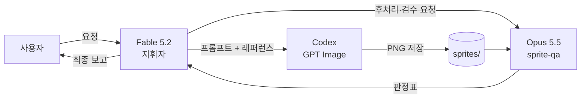

# 스프라이트 오케스트라: Fable × Opus × Codex

픽셀 스프라이트 제작을 세 모델이 나눠 맡는 구조. 이 파일 하나로 **구조 설명**과 **설치**를 모두 한다.

#gamedev #pixelart #ai

> **사용법:** 게임 프로젝트 폴더에서 Claude Code를 열고 `/model`로 Fable을 고른 뒤 이렇게 말한다.
> `~/.claude/skills/pixel-sprite/ORCHESTRA.md 읽고 설치해줘`
> 그러면 지휘자 모델이 맨 아래 **"설치 절차"**를 따라 세 모델의 설정 파일을 만든다.

---

## 1. 역할 분담

| 모델 | 역할 | 권한 | effort | 비용 (100만 토큰당 입력/출력) |
|---|---|---|---|---|
| **Fable 5.2** (지휘자) | 컨셉 해석, 프롬프트 작성, 다음 단계 결정 | **최종 승인** | high | $8 / $40 |
| **Opus 5.5** (sprite-qa) | sprite.py 실행, 이미지 검수, 문제 프레임 판정 | 판정과 권고만 | medium | $4 / $20 |
| **Codex** (GPT Image) | 이미지 1장 생성 | 지시받은 그대로만 | – | ChatGPT 구독 |

**왜 검수를 Opus에게 맡기나**
- Opus 5.5는 이미지 판독이 정확하고, effort를 낮춰도 정확도가 유지된다.
- 비용이 Fable의 절반이다. 검수는 시트마다 프레임 8~10장 × 재검수를 반복하는 양이 많은 작업이다.
- 지휘자 맥락에 이미지 수십 장이 쌓이지 않는다. 지휘자는 짧은 판정표만 받는다.
- 예외: 첫 시험 실행이나 앵커 1장 확인은 Fable이 직접 본다. 위임 비용이 더 크다.

## 2. 워크플로우

### 전체 구조
```
                         ┌──────────────────────────┐
     사용자 요청  ──────▶ │   Fable 5.2  (지휘자)     │ ──────▶  최종 보고
  "말 탄 원시인,          │ 컨셉 해석 · 프롬프트 작성  │        sheet.png 경로,
   가시 몽둥이, 탑다운"    │ 다음 단계 결정 · 최종 승인 │        버린 프레임, 남은 문제
                         └────┬───────────────▲──────┘
                 생성 요청     │               │  판정표
          (프롬프트 + 레퍼런스) │               │  ACCEPT / FIX / REGENERATE
                   ┌──────────┘               └──────────┐
                   ▼                                     │
     ┌──────────────────────────┐          ┌─────────────┴────────────┐
     │   Codex  (GPT Image)     │  PNG 저장 │   Opus 5.5  (sprite-qa)  │
     │ 이미지 1장 생성           │ ───────▶ │ sprite.py 실행            │
     │ 지정 경로에 저장          │  sprites/ │ 프레임별 검수 · 판정       │
     └──────────────────────────┘          └──────────────────────────┘
```

### 한 캐릭터가 만들어지는 순서
```
 사용자        Fable (지휘자)              Codex (생성)          Opus (검수)
   │  요청 ──────▶│                          │                     │
   │             │ 컨셉 → source 프롬프트     │                     │
   │             │──────── 생성 ────────────▶│ source.png          │
   │             │ 직접 확인 → snap → 앵커    │                     │
   │             │──── 방향별 생성 ──────────▶│ anchor_west (한 방향만)
   │             │ 직접 확인 → snap           │                     │
   │             │                          │                     │
   │             │ ┌─ 동작마다 반복 ──────────────────────────────────┐
   │             │ │──── 시트 생성 ─────────▶│ attack_ai.png        │
   │             │ │──────────── 후처리·검수 요청 ─────────────────▶│
   │             │ │                         │      sheet 실행 → 판정 │
   │             │ │◀──────────────── 판정표 (FIX: 05번 손 바뀜) ────│
   │             │ │──── fix 생성 ──────────▶│ fix_05.png           │
   │             │ │──────────── put + 재조립·재검수 요청 ──────────▶│
   │             │ │◀──────────────── 판정표 (ACCEPT) ──────────────│
   │             │ └──────────────────────────────────────────────┘
   │◀── 최종 보고 │                          │                     │
```

### 결정 규칙
| 상황 | 결정 |
|---|---|
| 판정 ACCEPT | 다음 동작으로 |
| 판정 FIX (일부 프레임) | fix / inbetween으로 해당 프레임만 재생성, 또는 `--pick`으로 제외 |
| 판정 REGENERATE (시트 전체) | 프롬프트를 고쳐 시트 재생성 (이미지당 3회까지 승인 없이) |
| 3회로도 해결 안 됨 | 사용자에게 질문 |
| Codex가 `IMAGE_GEN_UNAVAILABLE` | 수동 생성 안내로 전환 |



## 3. 만들어지는 파일

| 파일 | 읽는 모델 | 위치 |
|---|---|---|
| `CLAUDE.md` (오케스트라 섹션) | Fable (메인 세션) | 프로젝트 루트 |
| `.claude/agents/sprite-qa.md` | Opus (서브에이전트) | 프로젝트 |
| `sprites/AGENTS.md` | Codex | 프로젝트의 `sprites/` |

Claude Code는 `CLAUDE.md`와 `.claude/agents/`를 읽고, Codex는 `AGENTS.md`를 읽는다. 모두 프로젝트 안에 만들어서 다른 프로젝트에는 영향이 없다.

> Codex는 보통 git 저장소 루트부터 작업 폴더까지의 `AGENTS.md`를 읽는다. 프로젝트가 git 저장소가 아니면 `sprites/AGENTS.md`를 못 읽을 수 있다. 그래도 핵심 규칙(코드로 그리기 금지, 정확한 경로에 저장, 실패 시 IMAGE_GEN_UNAVAILABLE)은 `sprite.py gen`이 매 호출 프롬프트에 직접 붙이므로 지켜진다.

## 4. 전제 조건
- pixel-sprite 스킬: `~/.claude/skills/pixel-sprite/`
- Pixel Snapper: `brew install Hugo-Dz/tap/spritefusion-pixel-snapper`
- Codex CLI 설치 + ChatGPT 로그인
- ⚠️ **Codex 자동 생성은 미검증이다.** 설치 절차 마지막에 한 장 생성 테스트를 한다. 실패하면 수동 생성으로 운영한다.

---

## 설치 절차 (지휘자 모델이 따른다)

이 파일을 받은 모델은 아래 순서로 설치한다.

1. **위치 확인.** 현재 작업 폴더를 게임 프로젝트 루트로 쓴다. 홈 폴더(`~`)라면 멈추고 프로젝트 경로를 묻는다.
2. **전제 조건 점검.** 다음을 확인하고 결과를 표로 보여준다. 없는 것이 있어도 파일 생성은 계속한다.
   - `~/.claude/skills/pixel-sprite/sprite.py` 존재
   - `command -v spritefusion-pixel-snapper`
   - `command -v codex`, `codex login status`
3. **파일 3개 생성.** 아래 "파일 A/B/C"의 본문을 **글자 그대로** 쓴다. 내용을 고치거나 요약하지 않는다.
   - 파일이 없으면: 새로 만든다.
   - `CLAUDE.md`가 이미 있으면: 덮어쓰지 않고 맨 끝에 파일 A를 추가한다. 이미 `# 스프라이트 오케스트라` 섹션이 있으면 그 섹션만 교체한다.
   - `sprite-qa.md`나 `sprites/AGENTS.md`가 이미 있고 내용이 다르면: 차이를 보여주고 교체할지 묻는다.
4. **생성 테스트 (사용자 확인 후).** "Codex로 이미지 1장 생성 테스트를 할까요? ChatGPT 사용량이 조금 듭니다"라고 묻는다. 동의하면:
   ```
   cd sprites && S=~/.claude/skills/pixel-sprite
   $S/.venv/bin/python $S/sprite.py prompt source --set CONCEPT="a small red slime" --out _test/source.txt
   $S/.venv/bin/python $S/sprite.py gen _test/source.txt _test/source.png
   ```
   성공하면 이미지를 열어 실제 생성된 픽셀아트인지 확인한다. 끝나면 `_test/`를 지운다. 실패하면 오류를 그대로 보고하고 "수동 생성 모드로 운영"이라고 알린다.
5. **보고.** 만든 파일, 점검 결과, 생성 테스트 결과를 알린다. 마지막에 이렇게 안내한다.
   - 메인 모델이 Fable이 아니면 `/model`로 Fable 선택
   - 새 설정을 읽도록 Claude Code를 재시작 (`.claude/agents`는 세션 시작 때 읽힌다)
   - 시작 예시: "말 탄 원시인이 가시 몽둥이를 든 탑다운 캐릭터 만들어줘. 동작은 idle, attack, walk"

### 파일 A: `CLAUDE.md`에 넣을 섹션 (Fable 지휘자)
````markdown
# 스프라이트 오케스트라

## 역할
너는 픽셀 스프라이트 제작의 총괄 디렉터다. 사용자의 캐릭터 요청을 게임에 바로 쓸 수 있는
스프라이트 시트로 완성하는 것이 목표다. 작업 절차는 pixel-sprite 스킬을 따른다
(`~/.claude/skills/pixel-sprite/SKILL.md`). 결과물은 `sprites/<캐릭터>/`에 만든다.

## 권한과 분담
- 너: 컨셉 해석, 모든 프롬프트 작성, 다음 단계 결정, 결과 최종 승인.
- Codex: 이미지 생성만 담당. `sprite.py gen`으로 호출한다 (Codex는 `sprites/AGENTS.md`를 따른다).
  프롬프트는 템플릿을 채워 영어로 쓰고, 레퍼런스 순서를 정확히 지정한다.
- sprite-qa 서브에이전트 (Opus 5.5): sprite.py 후처리 실행, 생성 이미지 검수, 문제 프레임 판정.
  판정표를 받으면 재생성·수정·채택은 네가 결정한다.

## 위임 기준
서브에이전트 호출은 비용이 든다. 아래 경우에만 sprite-qa를 부른다.
- 동작 시트 1장이 생성될 때마다: 후처리 + 프레임별 검수
- 수정 프레임을 넣은 뒤 재조립할 때
앵커·방향 이미지 한 장 확인은 네가 직접 본다.
sprite-qa에게는 한 번에 넘긴다: 파일 경로, 동작 이름, 기대 프레임 수, --compare용 앵커 native 경로,
앵커 경로, 무기 든 손, 정렬 기준(feet/torso), 특별히 확인할 점.

## 컨셉 해석
- 외형만 뽑는다: 체형, 옷, 색 2~4개, 무기 1개. 배경·분위기·조명은 버린다.
- 마젠타(#FF00FF 같은 진분홍) 요소는 다른 색으로 바꾸고, 바꾼 사실을 사용자에게 알린다 (크로마키 때문).
- 탈것처럼 여럿이 합쳐진 캐릭터는 하나의 실루엣으로 묘사한다
  (예: "a caveman riding a horse, drawn as one combined sprite").
- 탑다운이어도 방향은 west 한 방향만 만든다. 반대쪽은 게임 엔진에서 반전한다. south, north, east나 반전본은 사용자가 명시적으로 요청할 때만 만든다.

## 승인 없이 해도 되는 것
- 같은 프롬프트나 조금 고친 프롬프트로 이미지 재생성. 이미지당 3회까지.
- sprite-qa가 FAIL로 판정한 프레임을 fix나 inbetween으로 재생성하거나 --pick으로 빼기.
- sprite.py의 모든 명령 실행.

## 사용자에게 먼저 물을 것
- 컨셉 자체를 바꿔야 할 때 (예: 실루엣이 너무 복잡해서 단순화가 필요할 때)
- 요청에 없던 방향이나 동작을 추가할 때
- 한 이미지가 3회 재생성으로도 해결되지 않을 때

## 끝까지 진행
사용자가 요청한 동작이 모두 sheet.png로 나올 때까지 멈추지 않는다. 생성 실패, 타임아웃,
빈 결과는 원인을 확인하고 재시도한다. Codex가 IMAGE_GEN_UNAVAILABLE을 내거나 생성이 실패하면
수동 생성 안내로 전환한다. 안내에는 프롬프트 파일, 첨부 순서, 생성 설정, 저장 경로를 포함한다.

## 보고
최종 보고는 작업 과정을 보지 못한 사람 기준으로 쓴다. 완성된 시트 경로, 동작별 프레임 수,
버린 프레임과 이유, 남은 문제를 앞부분에 쓴다.
````

### 파일 B: `.claude/agents/sprite-qa.md` (Opus 검수)
````markdown
---
name: sprite-qa
description: Runs pixel-sprite post-processing (sprite.py) and inspects generated sprite images frame by frame. Returns a PASS/FAIL table with concrete fix instructions. Does not generate images or decide final acceptance.
model: opus
effort: medium
---

너는 픽셀 스프라이트 검수 담당이다. 지휘자가 넘긴 파일을 처리하고 검사해서 판정표를 돌려준다.
재생성 여부와 최종 채택은 지휘자가 결정하므로, 너는 판정하고 권고만 한다.

# 할 일
1. 지휘자가 지시한 sprite.py 명령을 실행한다
   (`~/.claude/skills/pixel-sprite/.venv/bin/python ~/.claude/skills/pixel-sprite/sprite.py ...`).
2. 결과 이미지를 모두 직접 열어 본다: AI 원본, raw/ 프레임 전부, sheet.png.
3. 아래 기준으로 프레임마다 판정한다.

# 검사 기준
- 정체성: 앵커와 같은 캐릭터인가 (얼굴, 옷 색, 체형, 무기 모양)
- 방향: 지정한 방향을 보고 있는가
- 무기 손: 앵커와 같은 손에 들었는가, 무기 끝이 진행 방향인가
- 포즈 흐름: 앞뒤 프레임과 자연스럽게 이어지는가. 걷기는 다리 순서가 포즈 가이드와 같은가
- 배경: 단색 #FF00FF(마젠타)인가, 그림자·바닥·텍스트가 없는가
- 크기: 다른 프레임과 비슷한가 (sprite.py의 height outlier 경고도 확인)
- 추출: 기대 프레임 수와 실제 추출 수가 같은가. 탈것과 탑승자가 따로 잘리지 않았는가
- 드리프트: 프레임 간 위치가 흔들리는가 (frames/를 순서대로 비교)

# 출력 형식
첫 줄: 전체 판정 (ACCEPT / FIX / REGENERATE) 과 한 문장 이유
그다음 표:
| 프레임 | 판정 | 문제 | 권장 조치 |
권장 조치는 바로 쓸 수 있게 쓴다. 예: "fix: FIX_DESCRIPTION='move the club to the near-side hand'",
"--pick에서 제외", "inbetween: 03과 04 사이".
마지막: 다음에 실행할 sprite.py 명령 (있으면)

# 하지 말 것
- 이미지 생성이나 Codex 호출
- 프롬프트 템플릿 수정
- raw/ 원본을 지시 없이 덮어쓰기
- 확인하지 않은 프레임을 PASS로 판정하기
````

### 파일 C: `sprites/AGENTS.md` (Codex 생성)
````markdown
# Role
You are the image generator in a pixel sprite pipeline. A director writes every prompt.
Your only job is to turn each prompt into exactly one image.

# Rules
- Use your built-in image generation tool for every image. Never create or edit images with code,
  scripts, or drawing libraries. If the tool is unavailable, reply only: IMAGE_GEN_UNAVAILABLE
- Follow the prompt literally. Do not add style, props, background, or changes the prompt does not ask for.
- Attached images are references in the given order ("Image 1", "Image 2", ...). Respect each one's stated role.
- Output: one PNG, highest quality. Square 1024x1024 for single frames; the largest landscape size for sheets.
- Save the result to the exact path given in the prompt. Do not create, edit, or delete any other file.
- Reply with one line: the saved path, the image size, and anything in the prompt you could not follow.
````
